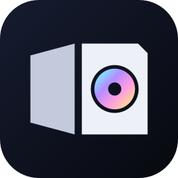
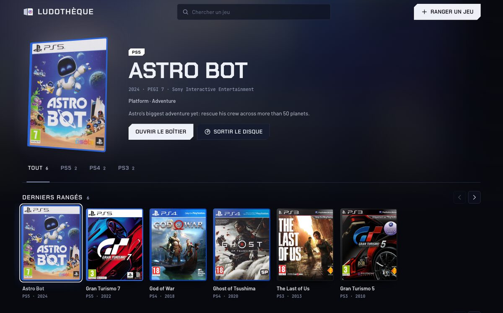
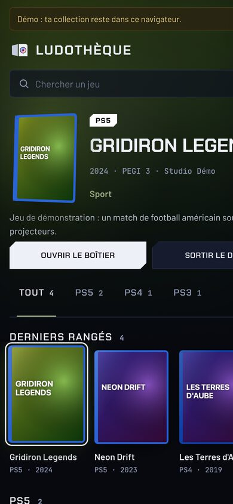
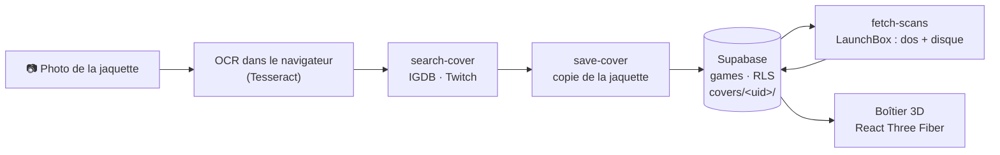

<div align="center">



# Ludothèque

**Ma collection de jeux PlayStation physiques, en vrais boîtiers 3D.**<br>
On photographie un jeu, la jaquette est retrouvée, et le boîtier s'ouvre sur son disque.

[](https://github.com/axsomette/ma-ludotheque-ps/actions/workflows/deploy.yml)


**[Ouvrir l'appli →](https://axsomette.github.io/ma-ludotheque-ps/)**


</div>

---

## Ce que ça fait

| Fonction | En pratique |
|---|---|
| **Photographier, c'est ranger** | Le titre est lu sur la photo **dans le navigateur** (Tesseract), la console est devinée grâce au bandeau, et la jaquette officielle est retrouvée sur IGDB. |
| **Des boîtiers fidèles** | Coque Blu-ray modélisée dans Blender (deux demi-coques, double charnière, moyeu à pétales, attaches à livret), plastique PS5 translucide, PS4 bleu, PS3 noir. Bandeaux et pictogrammes PEGI officiels, mise en page européenne. |
| **Le vrai dos, le vrai disque** | Scans récupérés sur LaunchBox Games DB, version européenne en priorité. À défaut, dos et sérigraphie générés à partir des données du jeu, ou tes propres photos. |
| **Dans la poche** | PWA installable sur iPhone et Android, interface disponible hors ligne, un compte e-mail + mot de passe et ta collection te suit partout. |

<p align="center">
  
</p>

Toucher un boîtier l'ouvre en 3D, aux proportions d'un vrai boîtier (135 × 171 × 15 mm) :

- **Face / Dos** : glisser pour tourner, il reprend sa pose au relâchement.
- **Ouvrir** : le couvercle pivote presque à plat sur la tranche, comme un vrai.
- **Disque** : il sort et tourne ; le toucher le retourne sur sa face gravée irisée.

Au clavier : `F` face, `D` dos, `O` ouvrir, `X` disque, `Espace` ouvrir / fermer, `Échap` retour.

<table>
  <tr>
    <td width="70%"></td>
    <td width="30%"></td>
  </tr>
  <tr>
    <td align="center"><sub>Accueil façon console : le jeu sélectionné en grand, puis des rangées par plateforme</sub></td>
    <td align="center"><sub>Sur téléphone</sub></td>
  </tr>
</table>

> Sans configuration, l'appli démarre en **mode démo** : quatre jeux d'exemple, la collection reste dans le navigateur.

## Comment ça marche



| Brique | Rôle |
|---|---|
| **Front** | Vite 8 · React 19 · TypeScript · React Three Fiber / drei · textures composées en canvas |
| **3D** | `public/models/case.glb`, généré par [`blender/build_case.py`](blender/build_case.py) ; grain du plastique fait dans TextureLucraft (`blender/tex/`) |
| **Données** | Supabase Postgres, table `games` protégée par RLS (chacun ne voit que ses jeux) |
| **Images** | Supabase Storage, bucket `covers`, écriture limitée à `covers/<uid>/` |
| **Serveur** | 3 Edge Functions Deno : `search-cover` (IGDB), `save-cover` (copie des images), `fetch-scans` (LaunchBox) |
| **Hébergement** | GitHub Pages, déployé par GitHub Actions après les tests |

<details>
<summary><b>Arborescence détaillée</b></summary>

| Élément | Rôle |
|---|---|
| `src/components/GameCase3D.tsx` | Boîtier 3D : coque GLB habillée selon la console, couvercle à charnière, disque irisé |
| `src/components/Library.tsx` | Accueil : jeu mis en avant, rangées et grille (CSS, sans Three.js) |
| `src/lib/canvasArt.ts` | Jaquette, tranche, dos et disque composés en canvas, mise en page européenne |
| `src/lib/ocr.ts` | Lecture du titre dans le navigateur : la photo n'est envoyée nulle part |
| `public/brand/consoles/`, `public/brand/pegi/` | Logotypes PS5 / PS4 / PS3 et pictogrammes PEGI (versions du domaine public, Wikimedia Commons) |
| `supabase/migrations/` | Table `games`, règles RLS, bucket `covers` |
| `supabase/functions/fetch-scans/launchbox.ts` | Lecture des pages LaunchBox, testée (`tests/launchbox.test.ts`) |
| `brand/` | Logo « Boîtier ouvert » et ses déclinaisons ([règles d'usage](brand/LOGO.md)) |

</details>

## Mise en route

<details>
<summary><b>1. Supabase</b></summary>

1. Créer un projet sur [supabase.com](https://supabase.com) (l'offre gratuite suffit).
2. Appliquer le schéma : coller les fichiers de `supabase/migrations/` dans **SQL Editor**, ou :
   ```bash
   supabase link --project-ref <ref>
   ```
   ```bash
   supabase db push
   ```
3. **Comptes e-mail + mot de passe** (Authentication → Sign In / Providers) : Email activé, inscriptions autorisées. Sans serveur SMTP personnalisé, Supabase n'envoie d'e-mails qu'aux membres de l'organisation : désactiver « Confirm email », ou brancher un SMTP (Authentication → Emails).
4. Authentication → URL Configuration : **Site URL** `https://<compte>.github.io/ma-ludotheque-ps/`, **Redirect URLs** la même adresse plus `http://localhost:5173/`.

</details>

<details>
<summary><b>2. Jaquettes (IGDB)</b></summary>

1. Créer une application « Confidential » sur [dev.twitch.tv/console](https://dev.twitch.tv/console).
2. Déclarer les secrets des fonctions, puis les déployer :
   ```bash
   supabase secrets set TWITCH_CLIENT_ID=xxx TWITCH_CLIENT_SECRET=yyy ALLOWED_ORIGINS=https://<compte>.github.io,http://localhost:5173
   ```
   ```bash
   supabase functions deploy search-cover
   ```
   ```bash
   supabase functions deploy save-cover
   ```
3. « Verify JWT with legacy secret » reste **désactivé** (déjà réglé par `supabase/config.toml`) : chaque fonction vérifie elle-même la session et renvoie 401 sans elle.

</details>

<details>
<summary><b>3. Vrais scans (LaunchBox Games DB)</b></summary>

Aucun compte ni secret. `fetch-scans` lit les pages publiques de [LaunchBox Games DB](https://gamesdb.launchbox-app.com/), choisit « Box - Back » et « Disc » en version européenne d'abord, puis copie les images dans `covers`.

```bash
supabase functions deploy fetch-scans
```

Pas d'API officielle : si LaunchBox change sa mise en page, adapter `launchbox.ts` (les tests le signalent). Jeu absent ou sans scan : le dos et le disque restent générés, ou photographiés.

</details>

<details>
<summary><b>4. GitHub Pages</b></summary>

1. Settings → Pages → Source : **GitHub Actions**.
2. Settings → Secrets and variables → Actions → **Variables** : `VITE_SUPABASE_URL` et `VITE_SUPABASE_ANON_KEY` (clé publique `sb_publishable_…`). Valeurs publiques par conception : la sécurité repose sur RLS.
3. Pousser sur `main` : le workflow teste, compile et publie.

</details>

### Développement local

```bash
npm install
```
```bash
cp .env.example .env.local
```
```bash
npm run dev
```

Sans `.env.local`, l'appli démarre en mode démo.

### Tests

```bash
npm test
```

Vitest : couleurs et PEGI, textes du dos, détection de plateforme et nettoyage du titre lu, collection en mode démo, messages d'authentification, lecture des pages LaunchBox. Le déploiement ne part que si les tests passent.

## Sécurité

- **Aucun secret dans le dépôt ni dans le navigateur** : les clés Twitch vivent dans les secrets Supabase, `.env.local` est ignoré par git.
- **RLS partout** : un utilisateur ne lit et n'écrit que ses jeux, et seulement dans `covers/<son id>/`.
- **Fonctions fermées par défaut** : session vérifiée dans chaque fonction (401 sinon), téléchargements limités à des hôtes fixés (CDN IGDB, images LaunchBox) avec identifiants validés.
- **Vie privée** : la photo de la jaquette est lue sur l'appareil ; les photos envoyées sont réencodées (métadonnées EXIF et GPS supprimées) et nommées au hasard.

Une faille ? Merci de la signaler en privé via les [GitHub Security Advisories](https://github.com/axsomette/ma-ludotheque-ps/security/advisories/new) plutôt qu'en issue publique.

## Crédits et limites

- Jaquettes et données : [IGDB](https://www.igdb.com/). Scans du dos et du disque : [LaunchBox Games DB](https://gamesdb.launchbox-app.com/). Ces images restent la propriété de leurs éditeurs : **usage personnel uniquement**.
- Logotypes PlayStation et pictogrammes PEGI : versions du domaine public sur [Wikimedia Commons](https://commons.wikimedia.org/). « PlayStation », « PS5 », « PS4 » et « PS3 » sont des marques de Sony Interactive Entertainment ; ce projet n'est ni affilié ni approuvé par Sony.
- La lecture du titre dépend de la photo (jaquette de face, bien éclairée) ; le titre lu reste modifiable avant la recherche.

<div align="center"><sub>Projet personnel · fait avec soin, une jaquette après l'autre.</sub></div>
